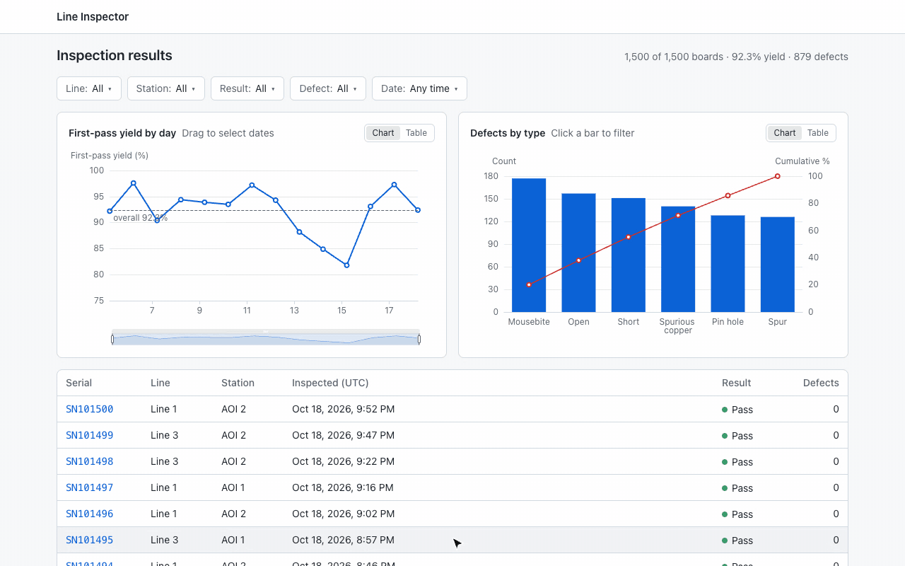

# Line Inspector

Find a yield problem on a PCB assembly line and trace it to the defect, the station and the board, all in the browser.

**Live demo:** https://pcb-yield-dashboard.vercel.app



## The user and their problem

A manufacturing or quality engineer gets thousands of automated optical inspection (AOI) results a day. When first-pass yield drops, they need to answer three questions fast:
- When did it start?
- What kind of defect is it?
- Is it one station or the whole line?

Then they want to look at an actual board to confirm it. Spreadsheet exports and static reports make that a slow, multi-tool hunt. Line Inspector does it on one page, and every view is a shareable URL.

## The demo story (about 60 seconds)

1. **Spot it.** Daily first-pass yield sits around 93% and dips to 82–85% on Oct 14–15.
2. **Brush it.** Drag across the dip. The date filter goes into the URL, and the chart shades the range.
3. **Break it down.** In the defects-by-type Pareto for that window, shorts jump from least common to most common. Click the bar to filter by shorts.
4. **Inspect it.** The grid narrows to 43 failed boards, mostly from Line 2 · AOI 2. Open one to see:
   - its image with numbered defect boxes
   - zoom and pan
   - a side-by-side comparison with the defect-free reference, on a shared zoom
   - the station's recent results (17 of its last 20 boards failed)

## Data

The board images and defect boxes are real. They come from [DeepPCB](https://github.com/tangsanli5201/DeepPCB): 640×640 aligned image pairs, each a tested board and its defect-free template, with six annotated defect types.

**The production context is synthetic.** There's no public dataset that links PCB images to real line data, so `scripts/seed_instrumental.py` wraps the images in generated records:
- 1,500 boards over 14 days, each with a serial, line (L1–L3), AOI station, timestamp and pass/fail result
- a planted fault: a worn etch step on L2 feeding AOI-2 leaves copper bridges (shorts) on Oct 14–15

Failed boards show a DeepPCB tested image. Passed boards show a template. The seed script is deterministic, so rerunning it produces the same data.

## Key design decisions

- **Everything the user can change is in the URL.** Filters live in the query string, behind a typed parse/serialize helper that's unit-tested. Back/forward, reload and shared links all restore the exact view. The detail page keeps the query string, so "Back to results", Previous and Next stay inside the filtered list.
- **Charts drive filters, and each chart ignores the filters it controls.**
  - The yield chart keeps showing every date, with the selection shaded. It also ignores the result and defect-type filters, which would pin yield at 0% or 100%.
  - The Pareto keeps showing every defect type, so you can still see what else could be selected.
- **Chart options are pure functions.** `buildYieldOption` and `buildParetoOption` take data and return an ECharts option. That keeps the chart logic testable without a DOM. ECharts is tree-shaken and drawn on canvas, and is lazy-loaded behind a skeleton.
- **Data is read in the browser with no backend.** The seed script writes Parquet files, and [hyparquet](https://github.com/hyparam/hyparquet), a small pure-JS Parquet reader, reads them in full on load. That's about 40 KB of tables. Board images are lossless WebP so edges stay sharp when zoomed in; thumbnails are lossy WebP at about 1 KB.
- **Zoom and pan are a square SVG `viewBox` over the image's pixel coordinates.** That means the defect boxes need no coordinate conversion. The viewBox math is a set of pure, tested functions. Wheel, buttons, dragging and the keyboard all go through the same helpers. Strokes and labels stay the same size on screen at any zoom.
- **Accessibility:**
  - Every chart has a table view and an ARIA description.
  - Focus moves to the page heading on navigation.
  - The image viewer can be used entirely from the keyboard.
  - The virtualized grid keeps table semantics for screen readers.
- **Components:** Radix primitives are wrapped once (for example `<FilterSelect>`), and app code uses only those wrappers. Styling is Tailwind, with design tokens that switch for dark mode. The grid uses TanStack Virtual, so only the visible rows are in the DOM.

## Performance

These were measured on 2026-10-30 against the live site from headless Chrome on an M-series MacBook with no throttling, taking the median of 5 cold loads.

| Measure | Result |
| --- | --- |
| First contentful paint | 272 ms |
| Dashboard data ready (`line-data-ready` mark) | 216 ms |
| Transferred on first load | 406 KB |
| Filter update, 10,000 boards (Vitest benchmark, data work only) | 1.2 ms (budget 100 ms) |
| Board detail route (lazy chunk, gzip) | 4 KB |

## Run it locally

```bash
npm install
npm run dev        # http://localhost:5173
npm test           # Vitest: filters, URL helpers, aggregates, chart options, viewport math
```

The generated data is committed in `public/data/instrumental/`. To rebuild it, see the DeepPCB pipeline in [CLAUDE.md](CLAUDE.md). The short version:

```bash
.venv/bin/python scripts/seed_instrumental.py                          # sample: 1,500 boards
.venv/bin/python scripts/seed_instrumental.py --units 5000 --images 0  # scale test
```

**Stack:** Vite, React 19, TypeScript (strict), React Router data router, Apache ECharts, Radix UI, Tailwind, TanStack Virtual, hyparquet, Vitest. Hosted on Vercel.

## What's next

- Scale run at 5,000+ boards and a Lighthouse pass, then refresh the numbers above.
- Thumbnails in the grid, and a pass/fail toggle (Radix ToggleGroup) in place of the multi-select.
- Overlay "boards with the selected defect type" on the yield chart, so the spike shows over time as well as in the Pareto.
- Compare mode: two boards or two time windows side by side.
- Each board's route through earlier stations. The dataset doesn't include this yet, so the detail page shows the current station's recent results instead.

## Credits

- **DeepPCB:** board images and defect annotations by Sanli Tang et al., from "Online PCB Defect Detector On A New PCB Defect Dataset" (2019). https://github.com/tangsanli5201/DeepPCB. Copyright (c) 2018 tangsanli5201, MIT License. The images in `public/data/instrumental/` are WebP conversions of a subset.
- The line, station, timestamp and result data is synthetic and generated for this demo.
